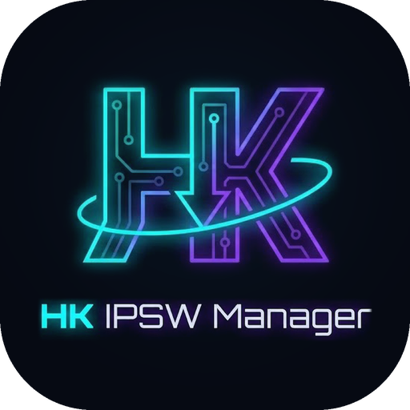

# HK Tools



**Made By Hisham Khateeb for the Community.**
Telegram: [t.me/xavior963](https://t.me/xavior963) · Website: [Hishamkhateeb.com](https://hishamkhateeb.com)

Flutter desktop app (Windows 10/11 x64 + macOS) for browsing, bulk-downloading,
deduplicating and auditing Apple IPSW firmware from IPSW.me v4.

## Layout

```
lib/
├── main.dart                           # Hive init, settings/catalog boxes, ProviderScope
├── core/theme, core/utils              # HUD tokens + theme, byte/rate/ETA formatting
├── domain/
│   ├── entities/                       # PlatformType, Device, IpswRelease/IpswGroup,
│   │                                   # DownloadTask, AppSettings
│   └── repositories/                   # DownloadTaskRepository, LinkResolver
├── data/
│   ├── api/ipsw_api_client.dart        # /devices, /device/{id}, /ipsw/{ver}, /model/{A-number}
│   ├── cache/catalog_cache.dart        # Hive: devices (24 h TTL), firmware (6 h TTL), model map
│   ├── repositories/                   # catalog (cache-first + parallel sync), settings, queue JSON
│   └── resolvers/ipsw_me_link_resolver.dart
├── services/
│   ├── catalog/                        # SearchQuery parser, CatalogIndex (search, dedupe, sort)
│   └── download/                       # chunked engine, queue manager, throttler, SHA1 isolate
└── presentation/
    ├── providers/                      # core, catalog, download, ui (Riverpod 3)
    ├── shell/                          # AppShell, Sidebar, HudHeader (search + telemetry)
    ├── widgets/hud_widgets.dart        # GlassPanel, NeonButton, PulseDot, Sparkline, …
    └── screens/
        ├── library/                    # browse + search, shared-payload tiles, bulk selection bar
        ├── queue/                      # bandwidth meter, per-thread visualizer, task controls
        ├── settings/                   # folders, threads, concurrency, caps, SHA1, cache
        └── repository/                 # inventory, missing-latest diff, duplicate reclaim
```

## Search syntax

`iPhone 15 Pro` · `Mac14,2` · `A2442` · `iOS 18.0.1` · `macOS Sequoia` · `22A3354` ·
`is:signed` / `is:unsigned` · `platform:ios|ipados|macos` · `chip:m-series` (or a SoC
prefix like `chip:t8112`) · `version:18.0` · `build:22A`. Bare numbers ("15") only match
device names, never OS versions.

## Download engine

- **Probe** `Range: bytes=0-0` → total size (from `Content-Range`), range support, ETag.
- **Pre-allocate** the `.hkdl` partial at full size (`SetEndOfFile` on NTFS),
  then every thread writes at its own offset. No merge step: finishing is a rename.
- **Dynamic segmentation**: a thread that finishes takes the back half of the
  largest remaining chunk, so one slow connection can't hold up the end of the file.
- **Resume**: chunk map checkpointed to `<file>.hkdl.json` every 3 s. Reused only
  if the remote size/ETag still match. Writes use `If-Range`, so if the file
  changed on the server you get a full-file 200 instead of the wrong bytes.
- **Link refresh**: 401/403/410 → `LinkResolver` re-queries IPSW.me for the same
  build/SHA1 → existing chunks resume on the new URL (up to 3 times per run).
- **SHA1** runs on a background isolate after the download slot is freed.

```
flutter test        # engine + manager tests against a local range server
flutter run -d macos   # or -d windows
```

## Repository scanner

- Finds every `.ipsw` under the repository folder and reads `BuildManifest.plist`
  straight from the ZIP/ZIP64 central directory (a few KB per file, no extraction).
- Matches files to the catalog by build + supported devices, with Apple's filename as
  a fallback; flags size mismatches, SHA1 mismatches and unreadable files.
- Results (and any computed SHA1) are cached per path + size + mtime, so rescans are instant.
- Hardlinked names are grouped as one physical file (`stat` inode / `fsutil hardlink list`).
- **Missing firmware**: devices whose latest signed IPSW isn't present, deduplicated by
  payload, with "Queue all missing".
- **Duplicates**: the same payload stored twice. Merging only happens when the SHA1s match,
  and replaces the extra copies with hardlinks (`ln` / `mklink /H`).
- **Per-device names**: `By Device/<identifier>_<version>_<build>_Restore.ipsw` hardlinks,
  created automatically after each download (Settings → Per-device hardlinks).

Dev/QA launch flags: `--dart-define=HK_START_SECTION=repository`,
`--dart-define=HK_START_SEARCH="is:signed platform:ios"`, `--dart-define=HK_REPO_DIR=/path`.

## Devices (iPhone / iPad management)

Built on the open-source [libimobiledevice](https://libimobiledevice.org) tools,
run as separate processes (LGPL, never linked). Feature set modelled on
iDescriptor; no iDescriptor (AGPL) code is used.

| Tab | What it does | Tool |
| --- | --- | --- |
| Overview | Activate, Skip Setup Assistant, identity (UDID, ECID, serial, IMEI…), battery health/cycles/temperature, storage, rename, restart/shutdown/sleep, enter/exit Recovery, pair/unpair | `ideviceinfo`, `idevicediagnostics`, `idevicepair`, `idevicename`, `ideviceenterrecovery`, `irecovery` |
| Apps | App icons, list user/system apps, install `.ipa`, uninstall, browse file-sharing app Documents | `ideviceinstaller`, `afcclient --documents` |
| Files | Browse the media partition, download, upload, rename, delete, new folder | `afcclient` |
| Contacts | Contacts from the device's local backups: search, details, duplicates, export to vCard / CSV | `idevicebackup2` + SQLite |
| Gallery | Camera-roll albums with thumbnails (Photos thumbnail cache, so HEIC previews), import selected / all | `afcclient` |
| Screen | Screenshots and a live view built from back-to-back captures | `idevicescreenshot` (needs a mounted DDI) |
| Console | Live syslog with filter, process filter, quiet mode, save | `idevicesyslog` |
| Backup | Full/incremental backups, encryption on/off, restore or delete a backup | `idevicebackup2` (passwords via `BACKUP_PASSWORD`, never argv) |
| Tools | Virtual location, Developer Disk Image mount, Developer Mode, crash reports, MobileGestalt query, raw lockdown values | `idevicesetlocation`, `ideviceimagemounter`, `idevicedevmodectl`, `idevicecrashreport` |
| Restore / Flash | Flash an IPSW from the repository (or any file) in update or erase mode | `idevicerestore -y -P` |

Devices in **Recovery** and **DFU** mode are detected with `irecovery -q` and can be flashed directly.

### Firmware restore (idevicerestore)

- Lists repository IPSWs whose `BuildManifest.plist` supports the device, with IPSW.me
  signing status; unsigned builds are blocked (Apple's TSS would refuse them). Offers to
  download the latest signed IPSW when none is local.
- Update keeps data; erase is forced for downgrades and DFU, and requires typing `ERASE`.
- Targets the device by ECID (stable across the Recovery → Restore reboots), runs with
  `-y` (no prompts) and `-P` (machine-readable `progress: <step> <fraction>`).
- Device polling pauses during a restore so `irecovery` never competes for the USB device.
- Extraction cache: `<app support>/restore_cache`; full logs: `<app support>/restore_logs`.

### Installing the tools

**macOS**
```
brew install libimobiledevice ideviceinstaller libirecovery
# idevicerestore is not in Homebrew:
brew install libtatsu libzip openssl@3 autoconf automake libtool pkgconf
git clone https://github.com/libimobiledevice/idevicerestore
cd idevicerestore && ./autogen.sh && make && sudo make install
```

**Windows**: install *Apple Devices* (Microsoft Store) or iTunes for the USB/usbmuxd and
Recovery/DFU drivers, then put Windows builds of the libimobiledevice tools and
`idevicerestore.exe` (with their DLLs) in a `tools\` folder next to `hk_tools.exe`,
or point Settings › Device tools at their folder.

The app searches: Settings folder → `tools/` next to the executable → `PATH` → Homebrew/MacPorts prefixes.

### Not included (yet)

AirPlay receiver (needs UxPlay), iFuse filesystem mounting (needs macFUSE/WinFsp), cable authenticity check, SSH terminal.

## App Store (sidebar › App Store)

Built on [ipatool](https://github.com/majd/ipatool) (MIT), run as a separate process.

- **Sign in with Apple ID**, including the two-factor code step. The password goes to
  Apple through `ipatool auth login` once and is never stored by this app; ipatool keeps
  only its session token (macOS Keychain; on Windows an encrypted file whose passphrase
  the app generates once in its app-support folder).
- The **first sign-in on a computer** makes ipatool download and prepare Apple's
  request-signing component (cached afterwards). That can take several minutes, so the
  dialog shows live status and elapsed time, allows up to 20 minutes, and can be cancelled.
- **Search** the store (iPhone / iPad), or list **My purchases**.
- **Download** the latest `.ipa`, or pick **any older version** from the version list.
  Free apps the account doesn't own yet are claimed automatically (`--purchase`);
  paid apps must already be bought.
- **Install** a downloaded app on a connected device (`ideviceinstaller`). App Store
  IPAs are FairPlay-encrypted: they run on devices signed in with the same Apple ID.
- Files land in `<Downloads>/HK Tools/App Store` by default; change it (or turn on
  "Ask where to save each IPA") in Settings › Downloads.

Install: `brew install ipatool` (macOS) or put `ipatool.exe` from the GitHub releases in
the device `tools\` folder (Windows).

## Interface size

Settings › Interface › *Interface size* (75–125%). Windows defaults to 90% because the
usual 125–150% display scaling makes the UI large. The window opens at up to 1280×800,
centered and never larger than the screen, and the interface shrinks further when the
window is smaller than the layout needs, so nothing overflows.

## Activation, Skip Setup and app icons

These use [pymobiledevice3](https://github.com/doronz88/pymobiledevice3) (GPL-3.0),
run as a separate process: `pip install pymobiledevice3` (macOS/Windows). The app finds
it on PATH and in Python's user script folders.

- **Activate** (Overview › Activation & Setup): `pymobiledevice3 activation activate`.
  It sends the same request as Finder/iTunes to Apple's activation server. Activation Lock
  is enforced by Apple and is never bypassed: a locked device needs the owner's Apple ID.
- **Skip Setup**: writes an unsupervised cloud configuration (`SkipSetup` list) through
  the device's configuration service, the mechanism Apple Configurator uses. Choose which
  screens to keep (Language & Region, Wi-Fi, Apple ID, Passcode/Face ID, Location); the
  rest are skipped, then the device restarts. Only works while the device is in Setup
  Assistant, after it has been activated.
- **Factory reset** (Overview › Actions): "Erase All Content and Settings" through the
  device's configuration service (`pymobiledevice3 profile erase-device`), the same as
  Apple Configurator's Erase. Requires typing `ERASE`; option to keep the eSIM / data plan.
  The device keeps its iOS version and restarts into Setup Assistant; Activation Lock
  still applies if Find My was on.
- **App icons** (Apps tab and App Store): looked up in batches from Apple's public
  iTunes Search API (only the installed bundle IDs are sent), then built-in apps are read
  from the device's SpringBoard via pymobiledevice3. Icons are cached in
  `<app support>/app_icons`.

## Download folders

Settings › Downloads:

- **IPSW download folder**: where firmware downloads land; also the repository the scanner audits.
- **IPA download folder**: App Store downloads. Default `<Downloads>/HK Tools/App Store`.
- **Ask where to save each IPA**: pick a folder for every app download.
- **Device data folder** (Settings › Device tools): backups, screenshots, photos, logs.
  Default `<Downloads>/HK Tools/Device Data`.

Before a download starts, the folder is created and write-tested. An unplugged external
drive (`/Volumes/…`, `E:\`), a missing permission, a read-only volume or a full disk
produces a plain message with a shortcut to Settings, instead of a raw `PathAccessException`.

## IPA Library (sidebar › IPA Library)

Lists every `.ipa` in the IPA library folder (Settings › Downloads, or the folder button
in the library header), up to 3 subfolder levels deep.

- Reads each IPA's `Info.plist` (binary or XML) and `iTunesMetadata.plist` straight
  from the ZIP: name, bundle ID, version, build, minimum iOS, App Store id. Results are
  cached by path, size and date, so rescans are instant.
- Versions of the same app are grouped (newest first; older ones installable from the
  ⋮ menu, or deletable).
- **Install** to the chosen connected device; shows whether the app is installed and
  whether the device has an older version (**Update on device**).
- **Updates**: the latest App Store version of every library app is checked through
  Apple's public lookup API (only bundle IDs are sent). **Update** / **Update all**
  download the new version with your Apple ID (ipatool) into the library and remove the
  old file, unless *Keep old versions* is on. The sidebar shows how many updates exist.
- **Add IPAs…** copies existing files into the library; files that aren't valid IPAs
  are listed separately.

## Contacts (Devices › Contacts)

iOS exposes the address book to a computer only through backups (or Apple's sync
protocol), so contacts are read from the device's local backups, from HK Tools'
backup folder and from Finder / iTunes backups on this computer. **Back up now** makes a
fresh one. Reading never changes anything on the device or in the backup (the database
is copied to a temp folder first).

- Name, organisation, phones, emails, addresses, websites, birthday, notes and photo.
- Search by name, number (digits match any format) or email; filter duplicates
  (contacts sharing a number or email) or contacts without a phone.
- Export the selection, or everything shown, to vCard 3.0 (`.vcf`, photos included) or CSV.
- Encrypted backups can't be read; turn backup encryption off and back up again.

## Windows requirements & setup assistant

At startup (and from Settings › Device tools › **Setup assistant**) HK Tools checks
what it needs and offers to install anything missing in one click:

| Component | Needed for | Installed from |
| --- | --- | --- |
| Apple device drivers (**required**) | USB access (Apple Mobile Device Service), Recovery/DFU drivers | *Apple Devices*, Microsoft Store (`winget … 9NP83LWLPZ9K`); opens the Store if winget is missing |
| libimobiledevice tools (**required**) | detection, info, files, backups, screen, console | [jrjr/libimobiledevice-windows](https://github.com/jrjr/libimobiledevice-windows) release zip, pinned SHA-256 |
| idevicerestore / irecovery / ideviceinstaller | flashing, Recovery/DFU detection, app installs | your own build via `.github/workflows/windows-device-tools.yml` (set `windowsExtrasRepo`) |
| ipatool | App Store + IPA library updates | official [ipatool](https://github.com/majd/ipatool) release, pinned SHA-256 (x64/ARM64) |
| Python 3 | runs pymobiledevice3 | `winget install Python.Python.3.12` (per user) |
| pymobiledevice3 | activation, skip setup, factory reset, icons; app install fallback | `pip install --user pymobiledevice3` |

Downloads are verified before anything is unpacked into
`%LOCALAPPDATA%\HK Tools\tools` (no administrator rights needed), which the app
searches automatically. Without ideviceinstaller, app list/install/uninstall use
pymobiledevice3. The Visual C++ runtime is bundled next to `hk_tools.exe` by the
Windows build, so the app starts even on a clean PC.

On macOS the same assistant uses Homebrew and pip.
